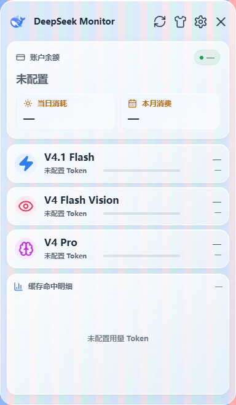
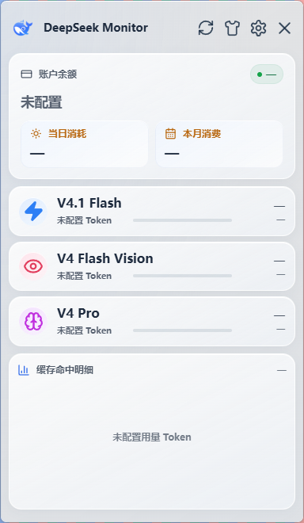

# DeepSeek Monitor Windows

[简体中文](README.md) | [English](README_EN.md)

DeepSeek Monitor Windows 是一个面向 Windows 的 DeepSeek API 用量监控桌面应用，用于查看账户余额、当月消费、模型 Token 用量和最近用量趋势。

> **维护说明**
>
> 本仓库是 [Joyi-code/DeepSeekMonitorWindows](https://github.com/Joyi-code/DeepSeekMonitorWindows) 的社区续作。上游自 2026 年 6 月发布 v1.1.0 后长期未更新，社区提交的改进（新模型用量、窗口缩放、安全加固）一直没有合并，因此由 [kakaluote1014](https://github.com/kakaluote1014) 在该基础上继续维护并发布 v1.2.0。
>
> 原项目作者 Joyi-code 的开源工作是本项目的全部基础，本项目继续沿用 MIT 许可、保留全部版权声明与贡献者署名。

本项目基于 [JayHome137/DeepSeekMonitor](https://github.com/JayHome137/DeepSeekMonitor) 的开源项目思路做 Windows 系统适配，**感谢原作者 JayHome137 的开源工作**。原项目是使用 Swift、SwiftUI、AppKit 和 WidgetKit 开发的 macOS 菜单栏与桌面小组件应用，用于监控 DeepSeek V4 Flash / Pro 的账户余额、Token 用量和消费情况。本项目面向 Windows 桌面端，技术栈和使用方式已经按 Windows 平台重构实现。

郑重声明：本项目不是 DeepSeek 官方产品。

## About

DeepSeek Monitor Windows is a Windows desktop adaptation inspired by JayHome137/DeepSeekMonitor. It is built with Tauri, React, TypeScript, and Rust to monitor DeepSeek balances and usage.

## 页面截图

原生 Acrylic 功能的 Windows 11 build 22631 实测。截图来自候选程序的独立配置和 WebView 目录，账户未配置，窗口背后是受控彩色条纹测试背景。

关闭原生毛玻璃时，背景条纹清晰可见：



开启后，Windows 对窗口背后的条纹进行模糊。v1.2.2 在设置页「外观 → 桌面毛玻璃」中开启，默认关闭：



v1.2.1 浅色磨砂玻璃主题：银白半透明底、淡蓝高光，以及统一的卡片、设置页和详情页材质。点击主面板顶部的衣服图标可切换主题，已有主题选择会保留。

下图使用浏览器演示数据，仅展示界面样式；本版本未接入 Windows 原生桌面背景模糊。


v1.2.0 主面板，默认窗口 384×660，仪表盘新增 V4 Flash Vision 行：


窗口可自由拉伸，拉高后图表完整展开（600×900）：


最小窗口 340×540 仍保持完整布局，内容超出时可纵向滚动：


历史界面（v1.1.0）：


## 上游项目与致谢

| 项目 | 说明 |
| --- | --- |
| [Joyi-code/DeepSeekMonitorWindows](https://github.com/Joyi-code/DeepSeekMonitorWindows) | 本仓库的直接上游，Tauri + React + Rust 的 Windows 实现 |
| [JayHome137/DeepSeekMonitor](https://github.com/JayHome137/DeepSeekMonitor) | 最初的 macOS 菜单栏版本，Windows 版的视觉与功能参考 |
| [Tsuki-hash](https://github.com/Tsuki-hash)（PR #11） | v1.2.0 采纳：`deepseek-v4-flash-vision-exp` 用量监控、窗口可缩放与响应式布局 |
| [KerryChia](https://github.com/KerryChia)（PR #1） | v1.2.0 采纳：CSP、DPAPI 凭据加密、权限收敛等安全加固 |
| issue [#9](https://github.com/Joyi-code/DeepSeekMonitorWindows/issues/9)、[#10](https://github.com/Joyi-code/DeepSeekMonitorWindows/issues/10) | 窗口缩放适配与新模型用量缺失的问题反馈 |

上游 PR #1 与 PR #11 至今未被合并，v1.2.0 在其代码基础上做了整合、兼容性处理与补充修复。

问题反馈、功能建议请直接在本仓库提 [Issue](https://github.com/kakaluote1014/DeepSeekMonitorWindows/issues)。上游原作者的个人社交联系方式（微信、抖音等）不属于本仓库维护范围，已从本仓库文档中移除。

## 当前能力

- 查询 DeepSeek API 账户余额，使用 DeepSeek 官方余额接口。
- 查询 DeepSeek 平台用量数据，包括当月消费、模型 Token 总量、请求数、缓存命中、缓存未命中和输出 Token。
- 支持 V4 Flash（`deepseek-flash`，兼容旧 ID `deepseek-v4-flash`）、V4 Flash Vision（`deepseek-v4-flash-vision-exp`）与 V4 Pro 三类模型用量展示；同一模型的历史 ID 与别名会自动归并到一行。
- 模型 ID 改名或新增时不会静默丢数据：未识别的模型会计入当日与当月总量，并写入运行日志。
- 支持最近 7 天消费趋势图和模型详情页。
- 主窗口可自由拉伸缩放（340×540 至 600×1200），布局随窗口尺寸自适应，拉高窗口即可完整查看图表。
- 支持 Windows 托盘入口，主窗口默认不进入任务栏。
- 支持 API Key 保存、清除和余额验证。
- 支持用量 Token 自动同步和手动粘贴兜底。
- API Key 与用量 Token 使用 Windows DPAPI 加密后落盘，配置文件中不再出现明文凭据。
- UI 复用原 macOS 版本的视觉方向，并按 Windows Tauri 窗口做适配。

## 与原项目的关系

| 项目 | 原项目 deepseek-monitor | 本项目 DeepSeekMonitorWindows |
| --- | --- | --- |
| 目标平台 | macOS 菜单栏与 WidgetKit 桌面小组件 | Windows 桌面端 |
| 核心技术 | Swift 5.9+、SwiftUI、AppKit、WidgetKit | Tauri 2、React 18、TypeScript、Rust |
| 主要用途 | 查看 DeepSeek 余额、消费、Token 用量和趋势 | 查看 DeepSeek API 余额、消费、Token 用量和趋势 |
| 启动方式 | macOS 原生应用 | Windows 桌面应用 |
| 实现方式 | 原生 macOS 实现 | 按 Windows 技术栈重新实现 |

## 下载安装

从 [GitHub Releases](https://github.com/kakaluote1014/DeepSeekMonitorWindows/releases/latest) 下载并运行 `DeepSeekMonitorWindows_1.2.2_x64-setup.exe`。覆盖安装新版本前无需卸载旧版本。

v1.2.2 安装包 `DeepSeekMonitorWindows_1.2.2_x64-setup.exe` 的 SHA256：`76104C9355CBC53E2C036FE3859AA4BF889610276BA460F70212173A330CE194`。发布页同时提供 `*.sha256.txt` 校验附件。

原生桌面毛玻璃需要 Windows 11 22H2（build 22621）及以上版本；Windows 10 和较旧 Windows 11 可继续使用普通背景。

运行环境要求：

- Windows 10 或 Windows 11。
- Microsoft Edge WebView2 Runtime。Windows 11 通常已内置，Windows 10 如缺失需单独安装。

两点需要提前说明：

- 安装包未做代码签名，Windows SmartScreen 可能提示「未知发布者」，需要手动选择「仍要运行」。
- v1.2.0 起凭据以 DPAPI 密文存储。**如果回退到 v1.1.0 或更早版本，旧版本会把密文当作凭据内容，需要在设置页重新填写 API Key 与用量 Token。**

## 源码开发

开发环境要求：

- Node.js 18+ 和 npm。
- Rust 1.77.2+，建议使用 MSVC 工具链。
- Visual Studio Build Tools，需包含 Desktop development with C++ 相关组件。

Windows 源码开发需要安装 Visual Studio Build Tools 2022，并勾选 `Desktop development with C++`。`npm run tauri:dev` 和 `npm run tauri:check` 会自动探测本机 VS Build Tools 安装位置，无需手动配置固定路径。执行 `npx tauri build` 时，需确保当前终端可以使用 Rust MSVC 工具链。

```powershell
git clone https://github.com/kakaluote1014/DeepSeekMonitorWindows.git
cd DeepSeekMonitorWindows
npm install
npm run tauri:dev
```

开发检查：

```powershell
npm run tauri:check
```

构建安装包：

```powershell
npx tauri build
```

Tauri 打包目标当前配置为 NSIS 安装包，产物位于 `src-tauri/target/release/bundle/nsis/`。

如果出现 `Visual Studio Build Tools not found`，请安装 Visual Studio Build Tools 2022，并确认已勾选 `Desktop development with C++` 组件。

### 无 Rust 环境预览界面

只改界面的贡献者不需要安装 Rust 和 Visual Studio Build Tools：`npm run dev` 在普通浏览器里检测不到 Tauri IPC 时，会自动加载 `src/dev-mock.ts` 的演示数据，可直接看到仪表盘、设置页和详情页。生产构建会通过 `import.meta.env.DEV` 把这段代码整体剔除，不会进入 `dist` 产物。

### 持续集成与发版
仓库自带 GitHub Actions 工作流，本地不装 Rust 也能完成校验与发版：

- `.github/workflows/ci.yml`：每次推送和 PR 会执行前端 `tsc --noEmit` + `vite build`、Windows 上的 `cargo check --all-targets` 与 `cargo test`，并检查是否有凭据被误提交。
- `.github/workflows/release.yml`：推送形如 `v1.2.0` 的 tag（或在 Actions 页面手动触发并填入 tag）后，自动在 `windows-latest` 上编译 NSIS 安装包、计算 SHA256，并创建对应的 GitHub Release。

发版流程：

```powershell
# 1. 更新 package.json、src-tauri/Cargo.toml、src-tauri/tauri.conf.json 中的版本号
# 2. 提交并推送
git commit -am "release: v1.2.1"
git push origin master
# 3. 打 tag 触发云端构建与 Release
git tag v1.2.1
git push origin v1.2.1
```

## 使用方式

打开应用后进入设置页，先配置 DeepSeek API Key。API Key 用于查询账户余额，来自 DeepSeek 开放平台的 API Keys 页面。

DeepSeek 当前未公开记录账户级用量统计的 API 接口，因此用量统计需要通过网页登录获取用量 Token。用量 Token 与 API Key 不同，用于访问 DeepSeek 平台的用量接口，应按敏感会话凭据管理。

方式一，网页登录自动同步：

- 点击 `方式一：网页登录自动同步`。
- 在弹出的 DeepSeek 登录窗口完成登录。
- 登录成功后，应用会从登录窗口的网络请求与 WebView2 缓存中提取用量 Token。
- 同步成功后会自动刷新本月消费和 Token 统计。

方式二，手动粘贴用量 Token：

- 点击 `方式二：手动粘贴 token`。
- 按页面提示从浏览器控制台获取 `JSON.parse(localStorage.userToken).value`。
- 粘贴后保存，作为自动同步失败时的兜底方案。

**用量 Token 可能过期。用量查询失败时，重新执行网页登录同步或手动粘贴即可。**

## 数据存储

应用配置默认存储在：

```text
%APPDATA%\DeepSeekMonitorWindows\config.json
```

其中 `api_key` 与 `usage_token` 字段使用 Windows DPAPI（当前用户范围）加密后以 `enc1:<hex>` 形式保存，不再明文落盘；旧版本留下的明文凭据会在应用读取配置时自动迁移为密文。

**请不要提交、分享或备份该文件，也不要把截图、日志或配置文件中的密钥内容公开。使用共享电脑时，应在设置页清除 API Key 和用量 Token。** 更换 Windows 用户或重装系统后，DPAPI 密文无法解密，应用会把凭据视为未配置，需要重新填写。

WebView2 登录缓存通常位于：

```text
%LOCALAPPDATA%\com.deepseek.monitor.windows\EBWebView
```

该目录属于本机运行数据，不应提交到仓库。

## 安全说明

v1.2.0 在前端与登录窗口做了如下收敛：

- 启用 CSP 内容安全策略（开发模式单独配置），禁止内联脚本与外部资源加载。
- 关闭 `withGlobalTauri`，前端只通过 `@tauri-apps/api` 模块调用后端。
- 登录同步窗口使用独立的最小权限配置（`src-tauri/capabilities/login-sync.json`），不再授予远程页面 Tauri IPC 能力。
- 登录窗口增加导航白名单，仅允许 `platform.deepseek.com` 与 `api.deepseek.com`。
- 注入脚本仅拦截发往 DeepSeek 域名的请求，并移除了原先依赖 `__TAURI__` 的辅助通道。
- API Key 增加 256 字符上限与格式告警，用量 Token 增加 4096 字符上限。

## 项目结构

```text
DeepSeekMonitorWindows/
├── .github/workflows/           # CI 与 tag 发版工作流
├── src/                         # React + TypeScript 前端
│   ├── main.tsx                 # 主界面、设置页、详情页和 Tauri 调用
│   └── styles.css               # Windows 桌面 UI 样式
├── src-tauri/                   # Tauri + Rust 后端
│   ├── src/lib.rs               # API 调用、配置存储、凭据加密、托盘、网页登录同步
│   ├── tauri.conf.json          # Tauri 窗口、打包和安全配置（CSP 已启用）
│   ├── Cargo.toml               # Rust 依赖与包信息
│   └── capabilities/            # Tauri 权限配置
│       ├── default.json         # 主窗口权限
│       └── login-sync.json      # 登录窗口最小权限
├── public/assets/               # DeepSeek 图标与静态资源
├── scripts/                     # Windows 开发脚本
├── package.json                 # 前端依赖与脚本
├── README.md                    # 中文项目说明
└── README_EN.md                 # 英文项目说明
```

## 不应提交的文件

仓库已通过 `.gitignore` 忽略以下内容：

- `node_modules/`
- `dist/`
- `src-tauri/target/`
- `.env`, `.env.local`, `.env.*.local`
- `.npmrc`
- `*.log`, `*.err.log`, `*.out.log`
- `test-output/`
- 根目录临时截图 `dashboard-mvp.png`, `settings-mvp.png`, `detail-mvp.png`
- WebView2 缓存和本地运行配置
- IDE 配置和系统临时文件

CI 中另有一道凭据检查，会拒绝跟踪 `config.json`、`EBWebView` 目录，也会拒绝提交形如 `sk-...` 的疑似密钥。

## 主要依赖

前端运行依赖：

- React 18
- React DOM 18
- Tauri JavaScript API 2
- lucide-react

前端开发依赖：

- Vite 5
- TypeScript 5
- Tauri CLI 2
- React 类型定义

Rust 后端依赖：

- tauri 2.11，启用 tray-icon
- tauri-plugin-log
- tauri-plugin-single-instance，单实例守卫，防止应用重复多开
- reqwest 0.12，启用 json
- serde
- serde_json
- log

凭据加密直接调用 Windows 自带的 DPAPI（`crypt32`），未引入额外第三方依赖。

## 更新日志

完整发布记录见 [GitHub Releases](https://github.com/kakaluote1014/DeepSeekMonitorWindows/releases)。

### v1.2.2

- 接入 Windows 11 22H2 及以上的原生桌面 Acrylic，设置页「外观」新增默认关闭的「桌面毛玻璃」开关。
- 系统不支持或原生调用失败时保留普通背景；开关偏好单独保存在界面本地存储中，凭据配置格式保持不变。
- 原生材质随浅色/深色主题同步；启用时使用透明度更高的背景和适配的圆角。
- 已在 Windows 11 build 22631 上使用独立配置和 WebView 目录验收原生效果、标题栏拖动、三种窗口尺寸、焦点切换、偏好恢复和关闭回退。
- Rust 新增原生材质测试，完整单测为 11 项；未引入额外插件或依赖。
- 同步设置页的版本号回退显示。

### v1.2.1

安装包 SHA256：`D7F88BBCD204A3B38C2E722720D2A3D82975EC90B37586067C5DCE7211426767`。

- 升级浅色主题为银白磨砂玻璃风格，加入淡蓝高光、柔和阴影与统一的卡片、按钮、输入框材质，覆盖主面板、设置页和模型详情页。
- 主面板与详情页的 Flash 显示名称更新为 `V4.1 Flash`，继续保留旧模型 ID 的用量归并与 V4 Flash Vision 历史用量。
- 改善浅色主题的文本对比、键盘焦点提示与减少动态效果设置的支持。
- 主题仍通过顶部衣服图标切换并保存选择；本版本未接入 Windows 原生桌面背景模糊。

### v1.2.0

安装包 SHA256：`AB4A339F04F82C0A6E869FC02643FC0F1B8E2AC73D50026BC9EFB86933E1A48D`。

本版本由社区续作维护，整合了上游两个长期未合并的 PR，并补充修复其遗留问题。

功能改进（采纳 [Tsuki-hash](https://github.com/Tsuki-hash) 的 PR #11）：

- 新增 `deepseek-v4-flash-vision-exp`（V4 Flash Vision）用量监控：仪表盘新增第三个模型行（位于 V4 Flash 与 V4 Pro 之间），缓存命中趋势图合并该模型的命中/未命中/输出 Token，模型详情页支持查看其按日消耗。
- 主窗口支持缩放（最小 340×540，最大 600×1200），布局尺寸改为 `clamp()` 自适应，修复 issue #9 中「UI 无法适配缩放」的问题。

安全加固（采纳 [KerryChia](https://github.com/KerryChia) 的 PR #1）：

- API Key 与用量 Token 改为 Windows DPAPI 加密存储，不再明文写入 `config.json`。
- 启用 CSP 内容安全策略，关闭 `withGlobalTauri`，拆分登录窗口与主窗口权限，登录窗口增加域名导航白名单。
- 注入脚本增加域名白名单守卫，仅拦截发往 DeepSeek 域名的请求；移除依赖 `__TAURI__` 的辅助通道。
- API Key / 用量 Token 增加长度上限与格式告警。

模型 ID 变更修复（本仓库新增，issue #10 的根因）：

- DeepSeek 已把主力模型 ID 从 `deepseek-v4-flash` 更名为 `deepseek-flash`（V4.1 Flash）。旧版本硬编码了旧 ID，会导致当月真实用量整段漏掉——仪表盘的 V4 Flash 行显示 0，而实际用量只进了总量。这是本次发布最重要的修复。
- 现在按前缀归并模型 ID：`deepseek-flash`、`deepseek-v4-flash`、`deepseek-v4.1-flash-expires-on-0910` 归入 V4 Flash 行，`deepseek-v4-flash-vision-exp` 归入 V4 Flash Vision 行，`deepseek-v4-pro` 归入 V4 Pro 行；同一行的多个 ID 会合并统计，不再互相覆盖。
- 未识别的模型 ID 不再静默忽略：其用量仍计入当日与当月总量，并写入运行日志提示补充映射。
- 修复 token 校验只看 HTTP 状态码的问题：平台在 token 失效时返回 HTTP 200 + `code 40002/40003`，旧逻辑会把无效 token 当成有效；现在会解析响应体并给出「token 无效或已失效」的明确提示。
- `x-app-version` 请求头改为读取真实包版本（原先写死 `1.0.0`）。

续作维护者补充的修复：

- 凭据解密失败不再让整个配置读取失败（改为记录警告、按未配置处理），避免 DPAPI 异常时应用不可用。
- 旧版本遗留的明文凭据在读取配置时自动迁移为 DPAPI 密文。
- 为 CSP 补上 `connect-src`（`ipc:` / `http://ipc.localhost`），避免启用 CSP 后 Tauri IPC 被拦截。
- 开发模式单独配置 `devCsp`，保证 `tauri dev` 的热更新可用。
- 新增 GitHub Actions CI 与 tag 发版工作流，安装包由云端构建并附带 SHA256。

### v1.1.0

- 支持缓存命中、缓存未命中与输出 Token 的明细显示。
- 增加亮色 UI 皮肤，支持在主面板一键切换并记住用户选择。
- 设置页增加当前版本号显示。
- GitHub Release `v1.1.0` 曾标记为 Latest，安装包为 `DeepSeekMonitorWindows_1.1.0_x64-setup.exe`（历史保留）。
- 安装包 SHA256：`B13EF28BB7E803D923E1A00BCE4A873B4EB7F2F592AFF690173C2E9291F1D13F`。
- 历史 Release `v1.0.1` 和旧安装包继续保留，便于回退和版本追溯。

### v1.0.1

- 修复应用单实例缺失导致的重复多开问题，感谢抖音粉丝群烛阴兄弟提出的bug。此前在程序已运行的情况下再次点击图标或 exe，会不断启动新的进程；现在再次启动时不再新开窗口，而是将已有主面板唤到前台。通过接入 `tauri-plugin-single-instance` 单实例守卫实现。

### v1.0.0

- 首个正式发布版本，提供 DeepSeek API 余额查询、平台用量统计、消费趋势、Windows 托盘入口、API Key 与用量 Token 管理等能力。

## 后续计划

- 模型列表改为数据驱动，DeepSeek 上线新模型时无需改代码即可展示。
- 内置自动更新（`tauri-plugin-updater` + 本仓库 Releases），用户端可直接升级。
- 用量历史留存与 CSV/JSON 导出。
- 中英双语界面。

## 许可证

本项目使用 MIT License，与原项目 README 中声明的许可证保持一致。详见 [LICENSE](LICENSE)。

## 免责声明

本项目仅用于学习和研究目的。请遵守 DeepSeek 的使用条款，合理使用相关接口，避免频繁请求。

DeepSeek 平台页面结构、登录状态、WebView2 缓存和内部用量接口都可能变化，本项目不保证长期可用。**API Key 和用量 Token 已通过 Windows DPAPI 加密存储在本机，但使用者仍需自行承担账号安全、网络请求和数据展示带来的风险。**
