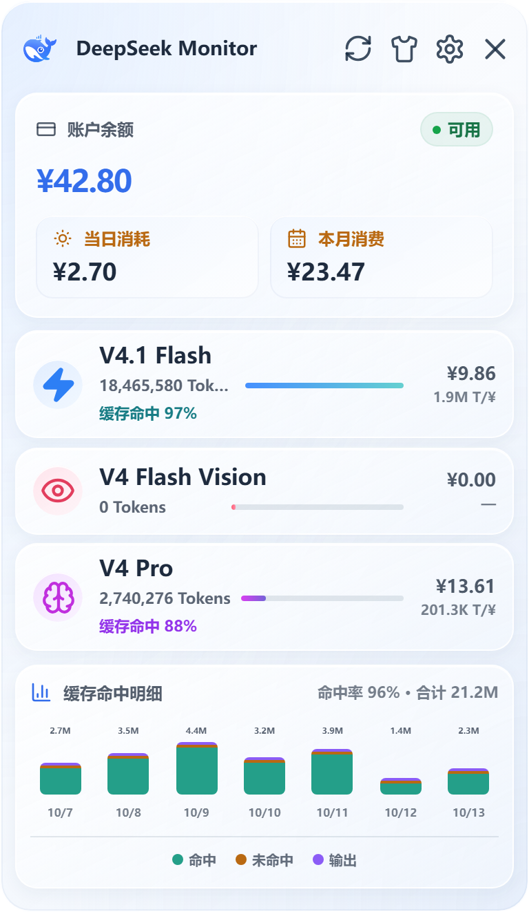
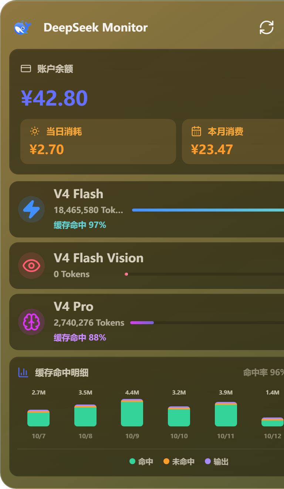
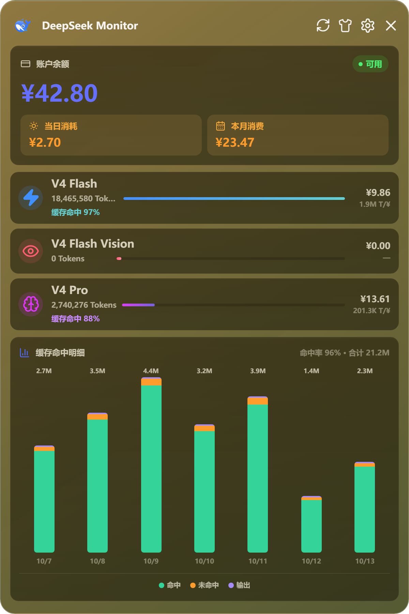
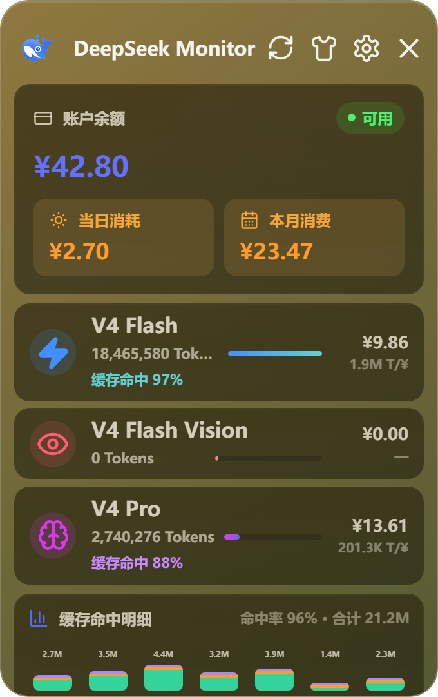

# DeepSeek Monitor Windows

[简体中文](README.md) | [English](README_EN.md)

DeepSeek Monitor Windows is a desktop application for monitoring DeepSeek API usage on Windows. It displays the account balance, monthly spending, model token usage, and recent usage trends.

> **Maintenance notice**
>
> This repository is a community continuation of [Joyi-code/DeepSeekMonitorWindows](https://github.com/Joyi-code/DeepSeekMonitorWindows). Upstream stopped shipping after v1.1.0 in June 2026 and never merged the community contributions for new models, window scaling, and security hardening. [kakaluote1014](https://github.com/kakaluote1014) therefore continues maintenance on that base and publishes v1.2.0.
>
> The original work by Joyi-code is the entire foundation of this project. This repository keeps the MIT license, the original copyright notice, and contributor attribution.

This project is a Windows adaptation inspired by the open-source project [JayHome137/DeepSeekMonitor](https://github.com/JayHome137/DeepSeekMonitor). **Many thanks to JayHome137 for the original open-source work.** The original project is a macOS menu bar and desktop widget application built with Swift, SwiftUI, AppKit, and WidgetKit. It monitors DeepSeek V4 Flash / Pro balances, token usage, and spending. This project reimplements the application with a Windows-specific technology stack and workflow.

Important: This project is not an official DeepSeek product.

## Screenshots

The v1.2.1 light frosted-glass theme uses a translucent silver-white surface, pale blue highlights, and consistent materials across cards, Settings, and model details. Use the shirt icon in the dashboard header to switch themes; existing theme preferences are preserved.

The following screenshot uses browser demo data to show the interface. This release does not enable native Windows desktop background blur.



The v1.2.0 dashboard at the default 384×660 window size, with the new V4 Flash Vision row:



The window is freely resizable; a taller window expands the chart (600×900):



The minimum window size 340×540 keeps the layout intact and scrolls vertically when needed:



Previous interface (v1.1.0):


## Upstream Projects and Credits

| Project | Description |
| --- | --- |
| [Joyi-code/DeepSeekMonitorWindows](https://github.com/Joyi-code/DeepSeekMonitorWindows) | Direct upstream: the Windows implementation built with Tauri, React, and Rust |
| [JayHome137/DeepSeekMonitor](https://github.com/JayHome137/DeepSeekMonitor) | The original macOS menu bar app that inspired the visuals and feature set |
| [Tsuki-hash](https://github.com/Tsuki-hash) (PR #11) | Adopted in v1.2.0: `deepseek-v4-flash-vision-exp` usage monitoring, resizable window, and responsive layout |
| [KerryChia](https://github.com/KerryChia) (PR #1) | Adopted in v1.2.0: CSP, DPAPI credential encryption, and permission hardening |
| issues [#9](https://github.com/Joyi-code/DeepSeekMonitorWindows/issues/9), [#10](https://github.com/Joyi-code/DeepSeekMonitorWindows/issues/10) | Reports about window scaling and the missing new-model usage data |

Upstream PR #1 and PR #11 were never merged. v1.2.0 integrates their code with compatibility work and additional fixes.

Please report bugs and feature requests in [this repository's issues](https://github.com/kakaluote1014/DeepSeekMonitorWindows/issues). The original author's personal contact channels (WeChat, Douyin) are outside the scope of this repository and have been removed from its documentation.

## Features

- Queries the DeepSeek API account balance through the official balance endpoint.
- Retrieves DeepSeek platform usage data, including monthly spending, total model tokens, request count, cache hits, cache misses, and output tokens.
- Displays usage for V4 Flash (`deepseek-flash`, also accepts the legacy `deepseek-v4-flash`), V4 Flash Vision (`deepseek-v4-flash-vision-exp`), and V4 Pro; historical and alias IDs of the same model are merged into one row.
- Renamed or newly added model IDs no longer drop data silently: unrecognized models still count toward the daily and monthly totals and are reported in the runtime log.
- Provides a seven-day spending trend chart and model detail pages.
- The main window is resizable (340×540 up to 600×1200) and the layout adapts to the window size, so charts are fully visible when the window is taller.
- Adds a Windows system tray icon while keeping the main window off the taskbar by default.
- Saves, clears, and validates the API key.
- Supports automatic usage token retrieval with manual paste as a fallback.
- Stores the API key and usage token encrypted with Windows DPAPI; credentials are no longer written to the configuration file in plaintext.
- Adapts the visual design of the original macOS version to a Windows Tauri window.

## Relationship to the Original Project

| Item | Original DeepSeekMonitor | DeepSeekMonitorWindows |
| --- | --- | --- |
| Target platform | macOS menu bar and WidgetKit desktop widget | Windows desktop |
| Core technology | Swift 5.9+, SwiftUI, AppKit, WidgetKit | Tauri 2, React 18, TypeScript, Rust |
| Primary purpose | View DeepSeek balances, spending, token usage, and trends | View DeepSeek API balances, spending, token usage, and trends |
| Launch method | Native macOS application | Windows desktop application |
| Implementation | Native macOS implementation | Reimplemented for the Windows technology stack |

## Download and Install

Download and run `DeepSeekMonitorWindows_1.2.1_x64-setup.exe` from [GitHub Releases](https://github.com/kakaluote1014/DeepSeekMonitorWindows/releases/latest). You do not need to uninstall an older version before installing an update.

SHA256 for the v1.2.1 installer `DeepSeekMonitorWindows_1.2.1_x64-setup.exe`: `D7F88BBCD204A3B38C2E722720D2A3D82975EC90B37586067C5DCE7211426767`. The release also includes a `*.sha256.txt` checksum asset.

Runtime requirements:

- Windows 10 or Windows 11.
- Microsoft Edge WebView2 Runtime. It is generally included with Windows 11. Install it separately on Windows 10 if it is missing.

Two things to know in advance:

- The installer is not code signed, so Windows SmartScreen may warn about an unknown publisher. Choose "Run anyway" to continue.
- Since v1.2.0, credentials are stored as DPAPI ciphertext. **If you roll back to v1.1.0 or earlier, the old version treats that ciphertext as the credential value, so you must re-enter the API key and usage token in Settings.**

## Source Development

Development requirements:

- Node.js 18 or later and npm.
- Rust 1.77.2 or later. The MSVC toolchain is recommended.
- Visual Studio Build Tools with the Desktop development with C++ workload.

Source development on Windows requires Visual Studio Build Tools 2022 with the Desktop development with C++ workload. `npm run tauri:dev` and `npm run tauri:check` automatically detect the local Visual Studio Build Tools installation, so no fixed path needs to be configured manually. Before running `npx tauri build`, make sure the Rust MSVC toolchain is available in the current terminal.

```powershell
git clone https://github.com/kakaluote1014/DeepSeekMonitorWindows.git
cd DeepSeekMonitorWindows
npm install
npm run tauri:dev
```

Run development checks:

```powershell
npm run tauri:check
```

Build the installer:

```powershell
npx tauri build
```

The current Tauri bundle target is an NSIS installer. Build artifacts are generated in `src-tauri/target/release/bundle/nsis/`.

If you see `Visual Studio Build Tools not found`, install Visual Studio Build Tools 2022 and verify that the Desktop development with C++ workload is selected.

### Browser Preview Without Rust

Contributors who only touch the UI do not need Rust or Visual Studio Build Tools: when `npm run dev` cannot detect Tauri IPC in a plain browser, it loads demo data from `src/dev-mock.ts` so the dashboard, settings, and detail views render immediately. Production builds drop that code entirely through `import.meta.env.DEV`, so it never reaches `dist`.

### Continuous Integration and Releases

The repository ships GitHub Actions workflows, so verification and releases work without a local Rust installation:

- `.github/workflows/ci.yml` runs the frontend `tsc --noEmit` and `vite build`, plus `cargo check --all-targets` and `cargo test` on Windows, and fails if credentials were committed.
- `.github/workflows/release.yml` builds the NSIS installer on `windows-latest`, computes its SHA256, and creates the GitHub Release when a tag such as `v1.2.0` is pushed (or when the workflow is started manually with a tag input).

Release flow:

```powershell
# 1. Bump the version in package.json, src-tauri/Cargo.toml, and src-tauri/tauri.conf.json
# 2. Commit and push
git commit -am "release: v1.2.1"
git push origin master
# 3. Push a tag to trigger the cloud build and release
git tag v1.2.1
git push origin v1.2.1
```

## Usage

Open the application and go to Settings to configure your DeepSeek API key. The API key is used to query the account balance and is available from the API Keys page on the DeepSeek platform.

The current application interface is in Simplified Chinese. The button labels below match the text shown in the application.

DeepSeek does not currently document a public API endpoint for account-level usage statistics. Usage statistics therefore require a usage token obtained through a DeepSeek web login. This token differs from the API key and is used to access the DeepSeek platform usage endpoint.

Method 1: automatic synchronization through web login

- Click `网页登录自动同步`.
- Sign in through the DeepSeek login window.
- After a successful login, the application extracts the usage token from the login window's network requests and from the WebView2 cache.
- After synchronization succeeds, the application automatically refreshes monthly spending and token statistics.

Method 2: manually paste the usage token

- Click `方式二：手动粘贴 token`.
- Follow the on-screen instructions and retrieve `JSON.parse(localStorage.userToken).value` from the browser console.
- Paste and save the token. This method serves as a fallback when automatic synchronization fails.

**The usage token may expire and should be treated as a sensitive session credential. If a usage query fails, repeat the web login synchronization or paste the token again. On a shared computer, clear it with `清除 Token` in Settings after use.**

## Data Storage

The application configuration is stored by default at:

```text
%APPDATA%\DeepSeekMonitorWindows\config.json
```

The `api_key` and `usage_token` fields are encrypted with Windows DPAPI (current-user scope) and stored as `enc1:<hex>`; credentials are no longer written in plaintext. Plaintext credentials left behind by older versions are migrated to ciphertext automatically when the application reads the configuration.

**Do not commit, share, or back up this file. Do not expose credentials in screenshots, logs, or configuration files. On a shared computer, clear the API key and usage token in Settings after use.** After switching Windows users or reinstalling the system, DPAPI ciphertext cannot be decrypted; the application then treats the credentials as unset and you must enter them again.

The WebView2 login cache is usually stored at:

```text
%LOCALAPPDATA%\com.deepseek.monitor.windows\EBWebView
```

This directory contains local runtime data and should not be committed to the repository.

## Security Notes

v1.2.0 tightens the frontend and the login window as follows:

- A Content Security Policy is enabled (with a separate development policy), blocking inline scripts and external resources.
- `withGlobalTauri` is disabled; the frontend talks to the backend only through the `@tauri-apps/api` modules.
- The login synchronization window uses its own minimal capability file (`src-tauri/capabilities/login-sync.json`) and no longer grants Tauri IPC access to remote pages.
- The login window restricts navigation to `platform.deepseek.com` and `api.deepseek.com`.
- The injected script only intercepts requests to DeepSeek hosts and no longer relies on the `__TAURI__` helper channel.
- The API key is limited to 256 characters with a format warning, and the usage token to 4096 characters.

## Project Structure

```text
DeepSeekMonitorWindows/
├── .github/workflows/           # CI and tag-triggered release workflows
├── src/                         # React and TypeScript frontend
│   ├── main.tsx                 # Dashboard, settings, details, and Tauri calls
│   └── styles.css               # Windows desktop UI styles
├── src-tauri/                   # Tauri and Rust backend
│   ├── src/lib.rs               # API calls, config storage, credential encryption, tray, web login sync
│   ├── tauri.conf.json          # Tauri window, bundle, and security settings (CSP enabled)
│   ├── Cargo.toml               # Rust dependencies and package metadata
│   └── capabilities/            # Tauri permission configuration
│       ├── default.json         # Main window permissions
│       └── login-sync.json      # Minimal permissions for the login window
├── public/assets/               # DeepSeek icons and static assets
├── scripts/                     # Windows development scripts
├── package.json                 # Frontend dependencies and scripts
├── README.md                    # Chinese project documentation
└── README_EN.md                 # English project documentation
```

## Files That Must Not Be Committed

The repository `.gitignore` excludes the following content:

- `node_modules/`
- `dist/`
- `src-tauri/target/`
- `.env`, `.env.local`, `.env.*.local`
- `.npmrc`
- `*.log`, `*.err.log`, `*.out.log`
- `test-output/`
- Temporary root screenshots: `dashboard-mvp.png`, `settings-mvp.png`, and `detail-mvp.png`
- WebView2 cache and local runtime configuration
- IDE configuration and operating system temporary files

CI also runs a credential guard that rejects tracking `config.json`, the `EBWebView` directory, and any committed value that looks like an `sk-...` key.

## Key Dependencies

Frontend runtime dependencies:

- React 18
- React DOM 18
- Tauri JavaScript API 2
- lucide-react

Frontend development dependencies:

- Vite 5
- TypeScript 5
- Tauri CLI 2
- React type definitions

Rust backend dependencies:

- tauri 2.11 with `tray-icon`
- tauri-plugin-log
- tauri-plugin-single-instance for single-instance protection
- reqwest 0.12 with `json`
- serde
- serde_json
- log

Credential encryption calls the DPAPI shipped with Windows (`crypt32`) and adds no third-party dependency.

## Changelog

See [GitHub Releases](https://github.com/kakaluote1014/DeepSeekMonitorWindows/releases) for the complete release history.

### v1.2.1

- Refreshed the light theme with silver-white frosted-glass surfaces, pale blue highlights, soft shadows, and consistent cards, buttons, and inputs across the dashboard, Settings, and model details.
- Updated the Flash display name to `V4.1 Flash` on the dashboard and detail page while preserving legacy model ID grouping and V4 Flash Vision usage history.
- Improved light-theme text contrast, keyboard focus indicators, and support for reduced-motion preferences.
- Themes remain selectable through the shirt icon and retain the saved preference. This release does not enable native Windows desktop background blur.

### v1.2.0

Installer SHA256: `AB4A339F04F82C0A6E869FC02643FC0F1B8E2AC73D50026BC9EFB86933E1A48D`.

This release is maintained by the community continuation. It integrates two long-unmerged upstream pull requests and fixes the issues left in them.

Feature work (adopted from [Tsuki-hash](https://github.com/Tsuki-hash)'s PR #11):

- Added usage monitoring for the `deepseek-v4-flash-vision-exp` (V4 Flash Vision) model: a new third model row on the dashboard (between V4 Flash and V4 Pro), the cache-hit trend chart merges this model's hit/miss/output tokens, and the model detail page shows its daily usage.
- The main window is now resizable (minimum 340×540, maximum 600×1200) and layout sizes use `clamp()` for responsive scaling, fixing "UI does not adapt to scaling" from issue #9.

Security hardening (adopted from [KerryChia](https://github.com/KerryChia)'s PR #1):

- The API key and usage token are now encrypted with Windows DPAPI instead of being written to `config.json` in plaintext.
- A Content Security Policy is enabled, `withGlobalTauri` is disabled, login-window and main-window permissions are split, and the login window gets a host navigation allowlist.
- The injected script now enforces a host allowlist and the `__TAURI__` helper channel was removed.
- Length limits and format warnings were added for the API key and usage token.

Model ID fix (new in this repository, the root cause behind issue #10):

- DeepSeek renamed the main model ID from `deepseek-v4-flash` to `deepseek-flash` (V4.1 Flash). Older builds hardcode the retired ID, so the current month's real usage was dropped entirely: the dashboard's V4 Flash row showed 0 while the usage only appeared in the combined total. This is the most important fix in this release.
- Model IDs are now grouped by prefix: `deepseek-flash`, `deepseek-v4-flash`, and `deepseek-v4.1-flash-expires-on-0910` map to the V4 Flash row, `deepseek-v4-flash-vision-exp` to the V4 Flash Vision row, and `deepseek-v4-pro` to the V4 Pro row. Multiple IDs in one group are summed instead of overwriting each other.
- Unrecognized model IDs are no longer ignored silently: their usage still counts toward the daily and monthly totals and is written to the runtime log so the mapping can be extended.
- Fixed token validation that only looked at the HTTP status: the platform answers with HTTP 200 plus `code 40002/40003` when a token is invalid, so the old logic accepted dead tokens. The app now parses the response body and reports "token invalid or expired" clearly.
- The `x-app-version` request header now uses the real package version instead of the hardcoded `1.0.0`.

Additional fixes by the continuation maintainer:

- A failed credential decryption no longer breaks configuration loading; it logs a warning and treats that credential as unset, so a DPAPI failure cannot brick the app.
- Plaintext credentials left by older versions are migrated to DPAPI ciphertext when the configuration is read.
- Added the missing `connect-src` (`ipc:` / `http://ipc.localhost`) to the CSP so enabling it cannot block Tauri IPC.
- Added a separate `devCsp` so `tauri dev` hot reload keeps working.
- Added GitHub Actions CI and a tag-triggered release workflow that builds the installer in the cloud and publishes its SHA256.

### v1.1.0

- Added detailed cache hit, cache miss, and output token statistics.
- Added a light UI theme that can be toggled from the dashboard and persists across sessions.
- Added the current version number to the Settings page.
- GitHub Release `v1.1.0` was marked as Latest. The installer is `DeepSeekMonitorWindows_1.1.0_x64-setup.exe` (kept for history).
- Installer SHA256: `B13EF28BB7E803D923E1A00BCE4A873B4EB7F2F592AFF690173C2E9291F1D13F`.
- The historical `v1.0.1` release and its installer remain available for rollback and version tracking.

### v1.0.1

- Fixed an issue that allowed multiple application instances to run at the same time. Thanks to Zhuyin from the Douyin community for reporting the bug. Previously, double-clicking the application icon or executable while the application was already running created another process. The `tauri-plugin-single-instance` guard now brings the existing dashboard to the foreground instead of opening another instance.

### v1.0.0

- First stable release with DeepSeek API balance queries, platform usage statistics, spending trends, a Windows system tray entry, and API key and usage token management.

## Roadmap

- Data-driven model list so new DeepSeek models show up without code changes.
- Built-in auto-update (`tauri-plugin-updater` plus this repository's releases).
- Usage history storage with CSV/JSON export.
- Chinese and English UI.

## License

This project is licensed under the MIT License, consistent with the license declared by the original project. See [LICENSE](LICENSE) for details.

## Disclaimer

This project is intended only for learning and research. Follow the DeepSeek terms of use, use the relevant endpoints responsibly, and avoid frequent requests.

DeepSeek page structures, login state, WebView2 cache behavior, and internal usage endpoints may change. Long-term availability is not guaranteed. **API keys and usage tokens are stored locally with Windows DPAPI encryption, but users remain responsible for account security, network requests, and the data displayed.**
